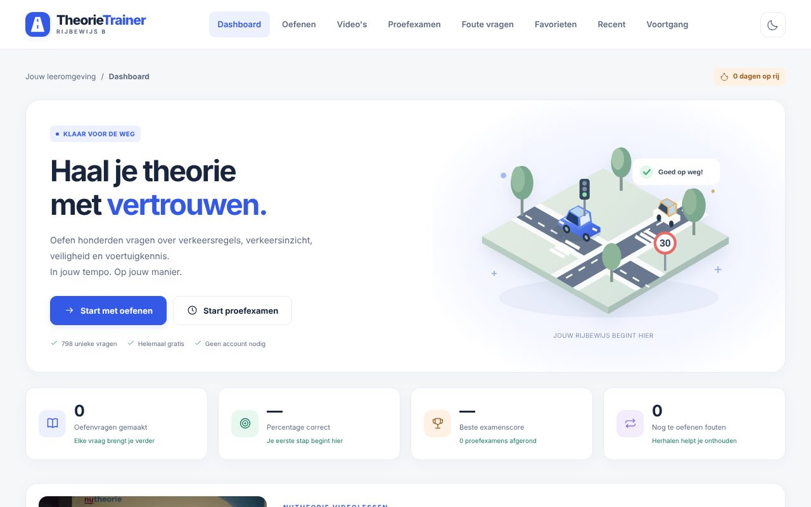

# TheorieTrainer — Rijbewijs B

Een Nederlandstalige oefenwebsite voor het auto-theorie-examen, met **798 oefenvragen**, **34 NuTheorie-videolessen**, proefexamens en persoonlijke voortgang. De site werkt volledig op je eigen apparaat: geen account, geen server, geen trackers.



## Snel starten

- **Op je computer:** dubbelklik `index.html`. Alles werkt offline in Chrome, Safari, Edge en Firefox, ook de video's. Alleen de bronlinks bij de uitleg hebben internet nodig.
- **Op je telefoon of tablet:** een telefoon kan geen map met losse bestanden openen. Start daarom op je computer `npm run start:telefoon` (of `node tools/server.cjs --lan`; Node.js 18 of nieuwer) en open op je telefoon het adres dat in beeld verschijnt. Telefoon en computer moeten op hetzelfde wifi-netwerk zitten. Stoppen doe je met Ctrl+C.
- **Alles controleren:** `npm test` (of `node tests/validate.cjs` en `node tests/images.cjs`).

## Inhoud

| Onderwerp | Vragen |
| --- | ---: |
| Verkeersregels | 288 |
| Verkeersborden en wegmarkeringen | 119 |
| Veilig rijden | 103 |
| Voertuigkennis | 73 |
| Gevaarherkenning en verkeersinzicht | 65 |
| Bestuurder, wetgeving en documenten | 56 |
| Bijzondere verkeersdeelnemers | 40 |
| Rijhulpsystemen (ADAS) | 29 |
| Milieu en verantwoord rijgedrag | 25 |
| **Totaal** | **798** |

De vragen komen uit drie bronnen. Bij **Oefenen** kies je welke je wilt gebruiken:

- **520 TheorieTrainer-vragen** (`questions.js`, `questions-extra.js`): eigen vragen met uitleg, beslissende details, uitleg per antwoordoptie, bronverwijzing en vaak een zelfgetekende illustratie.
- **161 NuTheorie-PDF-vragen** (ID 1001–1161, `questions-nutheorie.js`): vraag, opties, juist antwoord en uitleg overgenomen uit de vier aangeleverde PDF's (twee waren identiek). De volgorde van de opties blijft gelijk aan de PDF, omdat opties vaak naar "Bord A" of "Bord B" verwijzen. De 9 volgordevragen hadden in de PDF geen opties; daar kies je uit drie volgordes en zie je na het antwoorden de antwoordslide.
- **117 nieuwe vragen** (ID 2001+), waarvan **29 over rijhulpsystemen (ADAS)**: het onderwerp waar het CBR sinds 1 oktober 2026 meer nadruk op legt.

Moeilijkheid: 331 makkelijk, 337 gemiddeld en 130 moeilijk. 438 vragen hebben een afbeelding.

**Video's:** 34 NuTheorie-videolessen in hoofdstuk 1 tot en met 9 (samen ruim 7 uur), te openen via het menu-item **Video's** of de kaart op het dashboard. De speler toont de lessen van het huidige hoofdstuk, heeft knoppen voor vorige en volgende video, afspeelsnelheid (1×, 1,25×, 1,5×, 2×) en onthoudt waar je was. Een video telt als bekeken vanaf 90%; je kunt hem ook zelf afvinken. Met **Controleer alle video's** onder aan de pagina laat je de browser elke video laden en afspelen.

## Functies

- Oefenen per onderwerp, bron en niveau, met 10, 20, 30 of 50 vragen; slim oefenen, instinkers en alleen vragen met een afbeelding.
- Directe feedback met uitleg, beslissende details en uitleg waarom elk antwoord wel of niet klopt.
- Proefexamen met 52 vragen, waarvan 50 meetellen (9/7/7/6/5/4/4/5/3 per onderwerp, inclusief 3 ADAS-vragen), 30 minuten en een slaaggrens van 44/50. De twee testvragen zijn tijdens het examen niet herkenbaar en tellen niet mee.
- Foute vragen, favorieten, de 100 laatst beantwoorde vragen en een doorzoekbare bibliotheek.
- Voortgang per onderwerp, dagelijkse 10 vragen, oefenstreak, badges, en een sessie hervatten na herladen.
- Licht en donker thema, geschikt voor mobiel (tekst van minimaal 11 px, knoppen van minimaal 44 × 44 px), toetsenbordbediening en vergrootbare afbeeldingen.

De echte CBR-toets heeft ook twee oefenvragen vooraf en vraagvormen zoals animaties; deze trainer bootst die niet na. Dit zijn geen officiële CBR-vragen en het is geen CBR-product. De examenopzet is gecontroleerd via het [CBR](https://www.cbr.nl/nl/rijbewijs-halen/auto/theorie-examen-auto/hoe-gaat-het-theorie-examen-auto); regels zijn gekoppeld aan onder meer het [RVV 1990](https://wetten.overheid.nl/BWBR0004825/), Rijksoverheid en RDW. Regels kunnen veranderen; de vraagbank werkt zichzelf niet bij.

## Mappenstructuur

```
NutheorieOefenWebsite/
├── index.html              ← de website: open dit bestand
├── style.css               ← opmaak
├── script.js               ← alle interactie (geen framework)
├── questions.js            ← 220 TheorieTrainer-vragen
├── questions-extra.js      ← 300 TheorieTrainer-vragen
├── questions-nutheorie.js  ← 161 NuTheorie-PDF-vragen en 117 nieuwe vragen
├── videos.js               ← videolijst (gemaakt met tools/videos-manifest.py)
├── images/                 ← vraagillustraties, borden, NuTheorie-foto's (nutheorie/, nutheorie-nieuw/, nieuw/) en videoplaatjes (videos/)
├── Nutheorie_Videos/       ← 34 video's: Hoofdstuk1 … Hoofdstuk9, NN_Titel.mp4 (Git LFS)
├── traffic-images.js       ← generator voor de basisillustraties (niet nodig voor de website)
├── illustrations/          ← generators, manifest en overzichtsgalerij van de illustraties
├── tools/                  ← videos-manifest.py, server.cjs (voor je telefoon), code-bundle.py
├── tests/                  ← controles: validate.cjs en images.cjs
├── docs/                   ← VOLLEDIGE-CODE.md (leesbare broncodebundel) en schermafbeeldingen
├── extra/                  ← auto-theorie-oefentoets.html: de losse oefentoets (190 vragen in één bestand)
├── package.json            ← npm-opdrachten (geen pakketten nodig)
├── .gitignore / .gitattributes
├── _archief/               ← lokale back-ups en oude versies (niet in Git)
└── dist/                   ← gegenereerd pakket TheorieTrainer.zip (niet in Git)
```

De bestanden van de website staan bewust naast `index.html`: zo werkt de site door te dubbelklikken, zonder installatie of bouwstap. Laat `images/` en `Nutheorie_Videos/` naast `index.html` staan.

## Op GitHub zetten


GitHub weigert bestanden groter dan 100 MB, en zeven video's zijn groter (tot 228 MB; samen 2,5 GB). De video's gaan daarom via **Git LFS**; dat staat al ingesteld in `.gitattributes`. Een gratis account heeft 10 GiB LFS-opslag en 10 GiB LFS-downloadverkeer per maand. De video's gebruiken 2,35 GiB opslag, en elke volledige kloon kost ook zo'n 2,35 GiB verkeer: ongeveer vier keer klonen per maand. Bij een budget van € 0 blokkeert GitHub LFS tot de volgende maand als je erover gaat; er worden dan geen kosten gemaakt.

Eerste keer uploaden (installeer eerst [Git LFS](https://git-lfs.com), bijvoorbeeld met `brew install git-lfs`):

```
git lfs install
git init
git add .
git commit -m "TheorieTrainer met vragen en video's"
git branch -M main
git remote add origin https://github.com/JOUW-NAAM/JOUW-REPO.git
git push -u origin main
```

Controleer vóór het pushen met `git lfs ls-files` dat alle 34 video's in de lijst staan.

**Klonen:** zorg dat Git LFS geïnstalleerd is en kloon gewoon (`git clone …`); de video's komen dan vanzelf mee. Zie je op de videopagina de melding dat een video niet kan worden afgespeeld, voer dan in de projectmap `git lfs pull` uit. Na het klonen werkt de site direct door `index.html` te openen.

**Niet in Git:** `_archief/` (lokale back-ups), `dist/` (gegenereerd pakket) en systeembestanden zoals `.DS_Store`. Die blijven gewoon op je computer staan.

**GitHub Pages** is niet geschikt voor deze site: Pages serveert geen Git LFS-bestanden (de video's), een Pages-site mag maximaal 1 GB zijn, met een gratis account werkt Pages alleen voor openbare repositories, en publiceren zou het NuTheorie-materiaal openbaar maken. Gebruik de site lokaal, of op je telefoon via `npm run start:telefoon`.

**Liever zonder Git LFS?** Zet dan `Nutheorie_Videos/` in `.gitignore` en kopieer die map zelf naar elke computer. De rest van de site werkt ook zonder de video's; de videopagina meldt dan welke bestanden ontbreken.

## Ontwikkelen en controleren

Voor de website zelf is niets nodig. Voor de controles en hulpmiddelen gebruik je Node.js 18+ en Python 3, vanuit de projectmap:

- `npm test` — schema, aantallen, onderwerpverdeling, oefenen, examen, opslag, antwoordlogica, video's en afbeeldingen.
- `node tests/images.cjs http://localhost:8080/` — controleert daarnaast of alle lokale bestanden via http te laden zijn (start eerst `npm start`).
- `npm run videos` (`python3 tools/videos-manifest.py`) — na nieuwe of hernoemde video's: schrijft `videos.js` opnieuw. Speelduren en voorbeeldplaatjes alleen als `ffprobe`/`ffmpeg` aanwezig zijn.
- `npm run code-bundle` (`python3 tools/code-bundle.py`) — vernieuwt `docs/VOLLEDIGE-CODE.md`.
- Illustraties opnieuw opbouwen: eerst `node traffic-images.js`, daarna `node illustrations/extra.cjs` (in deze volgorde). De eerste schrijft de 117 basisillustraties en de afbeeldingsvelden in `questions.js`; de tweede bouwt 100 illustraties voor de uitbreiding en werkt manifest en galerij bij.
- Pakket zonder video's maken (macOS/Linux): `mkdir -p dist && zip -r dist/TheorieTrainer.zip . -x 'Nutheorie_Videos/*' '_archief/*' 'dist/*' 'extra/*' '.git/*' '*.DS_Store'`

## Opslag en privacy

Voortgang, favorieten en instellingen staan alleen in de browseropslag van je eigen apparaat (sleutels `theorietrainer.v1` en, voor de kijkvoortgang, `theorietrainer.videos.v1`). Er wordt niets verstuurd. Wissen van browsergegevens of een ander browserprofiel kan de voortgang verwijderen; op een telefoon (via de server) heb je een eigen, losse voortgang.
